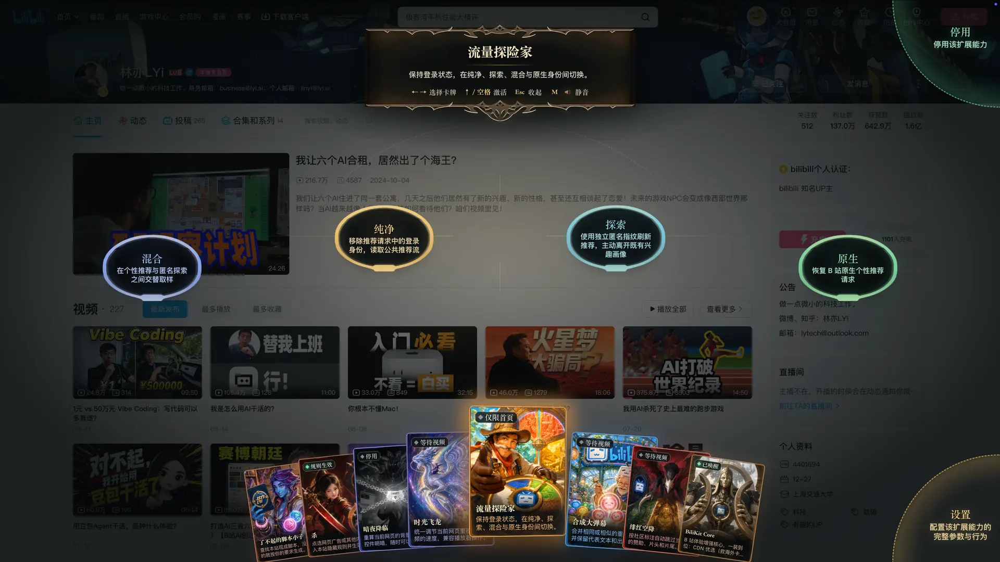
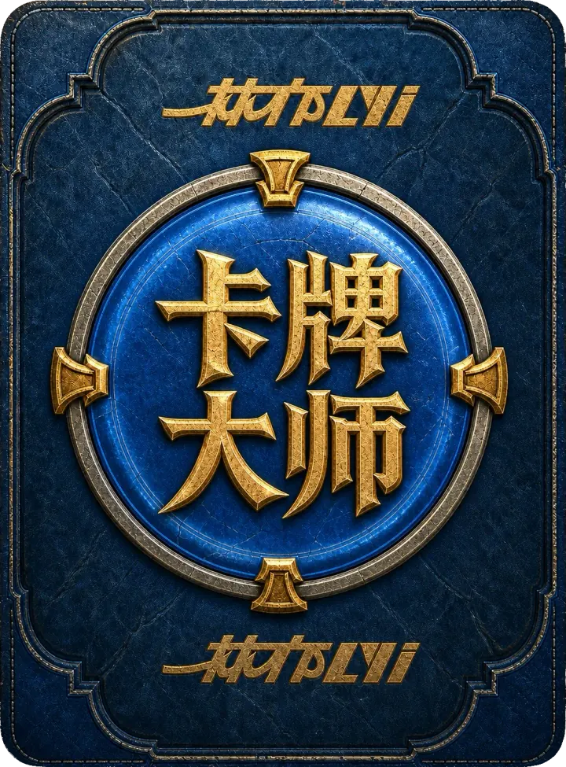
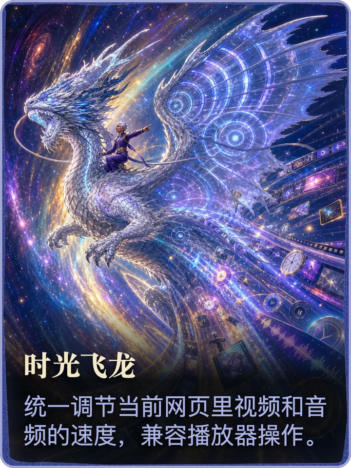
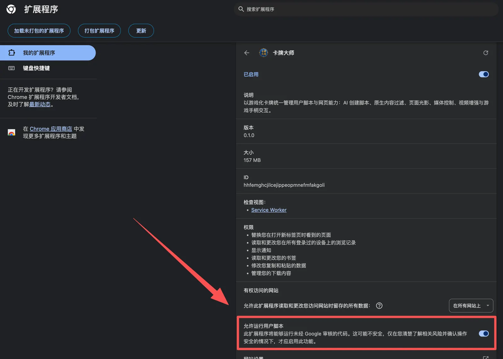
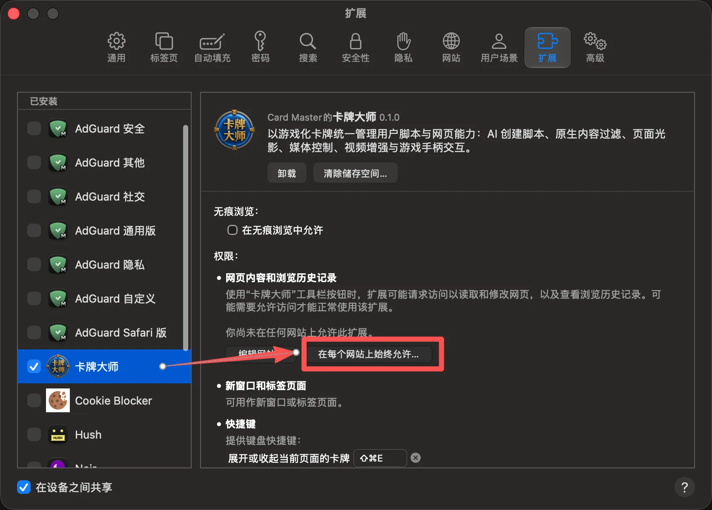

<div align="center">
  

  <h1>卡牌大師</h1>

  <p><a href="./README.md">简体中文</a> · <strong>繁體中文</strong></p>

  <p><a href="https://www.bilibili.com/video/BV12PtF6mEr4/"><strong>觀看林亦LYi 官方介紹影片</strong></a></p>

  <p><strong>以遊戲化卡牌統一管理使用者腳本與網頁功能。</strong></p>
  <p>AI 腳本生成 · 內容過濾 · 深色主題 · 媒體控制 · 影片增強 · 遊戲手把</p>

  <p>
    <a href="https://github.com/LYiHub/Card-master-browser-extension-public/releases/latest">
      
    </a>
    <a href="./LICENSE">
      
    </a>
    
  </p>

  <p>
    <a href="https://github.com/LYiHub/Card-master-browser-extension-public/releases/latest"><strong>下載發行版</strong></a>
    ·
    <a href="https://github.com/LYiHub/Card-master-browser-extension-public/issues">問題回報</a>
    ·
    <a href="https://space.bilibili.com/4401694">林亦LYi B 站主頁</a>
    ·
    <a href="./THIRD_PARTY_NOTICES.md">第三方聲明</a>
  </p>
</div>

## 介面一覽

<p align="center">
  
</p>

<p align="center">
  
  
  
  
</p>

<p align="center"><sub>卡背 · 殺 · 時光飛龍 · 了不起的腳本小子</sub></p>

## 核心功能

- 🌐 **簡體／繁體中文** — 介面與 AI 預設回覆支援簡繁切換，可跟隨瀏覽器介面語言或手動選擇
- 📜 **使用者腳本** — 安裝、匯入、更新、啟用、停用與隱藏；新安裝時預設啟用
- ✨ **AI 腳本工坊** — 搜尋、建立、解釋與修復腳本；相容 Responses 與 Chat Completions
- 🖼️ **新分頁** — AI 每日回顧桌布、電子相框與搜尋 · *Chromium / Firefox*
- ⚔️ **殺** — 點選隱藏廣告或其他內容
- 🌙 **暗夜降臨** — 重新調整頁面明暗 · 新安裝時預設停用
- 🐉 **時光飛龍** — 統一調整網頁影音播放速度
- 🐑 **順手牽羊** — 尋找並取得頁面媒體 · *Chromium / Firefox*，新安裝時預設停用
- 🎬 **影片增強** — 流量探險家、合成大彈幕、緋紅空降，以及 B 站 / YouTube SponsorBlock
- 🎮 **科樂美秘技** — 滑鼠、鍵盤、手把一套操作；包含螢幕鍵盤、拼音與語音輸入
- ☁️ **WebDAV 同步** — 在「設定 → 資料管理 → 跨裝置同步」連接自己的服務，同步腳本、卡牌與擴充功能設定，支援合併預覽、衝突選擇與歷史版本還原。

同一套核心程式碼支援 Chromium、Firefox 與 Safari 建置。目前提供 Chromium 與 Firefox 發行版下載；Safari 正式分發所需的簽章、公證及安裝驗證尚未完成。

## 介面語言

在「設定 → 介面語言」選擇「跟隨瀏覽器介面」「简体中文」或「繁體中文」。預設跟隨瀏覽器介面，也可以手動切換，重新整理後會保留選擇。

介面與 AI 預設回覆使用所選語言，既有腳本內容與歷史對話不會自動轉換。已開啟的內建工具需重新開啟或重新整理後才會生效。

## 安裝

到 [Releases](https://github.com/LYiHub/Card-master-browser-extension-public/releases/latest)
下載對應的 ZIP，並核對 `SHA256SUMS.txt`。

> 這些 ZIP **不是安裝程式**。Chromium 核心瀏覽器與 Firefox 都需要先解壓縮，再載入
> 直接包含 `manifest.json` 的資料夾。

| 平台 | 下載檔案 | 載入方式 |
| --- | --- | --- |
| Chromium（Chrome、Edge、Arc 等） | `card-master-chromium.zip` | 解壓縮 → 載入未封裝的擴充功能 |
| Chromium（保留瀏覽器原有的新分頁） | `card-master-chromium-browser-new-tab.zip` | 解壓縮 → 載入未封裝的擴充功能 |
| Firefox | `card-master-firefox.zip` | 解壓縮 → 暫時載入附加元件 |
| Firefox（保留瀏覽器原有的新分頁） | `card-master-firefox-browser-new-tab.zip` | 解壓縮 → 暫時載入附加元件 |
| macOS Safari | 暫不提供下載 | 正式分發所需的簽章、公證及安裝驗證尚未完成；背景說明見 [Issue #2](https://github.com/LYiHub/Card-master-browser-extension-public/issues/2) |

### 更新既有安裝

**請勿移除現有擴充功能。** 將新版檔案完整覆寫到原安裝目錄（直接包含 `manifest.json` 的資料夾），在擴充功能管理頁點選「重新載入」，再重新整理網頁及新分頁。

請保留原本的**完整路徑**，不要清除擴充功能儲存資料，也不要改從新目錄重新載入；只有資料夾名稱相同、位置不同，仍無法保證讀取原有資料。發行包自 v0.3.3 起使用固定名稱，版本仍可在 Release 與擴充功能詳細資料中查看；固定檔名不會自動更新擴充功能。

建議更新前先在設定中匯出牌庫留存。目前牌庫匯出包含使用者腳本及其管理資訊、封面，**不包含 API 設定及所有系統設定**，無法作為移除後重新安裝的完整備份。

### 保留瀏覽器原有的新分頁

請選擇檔名包含 `browser-new-tab` 的發行包。它與同平台標準版只有 `manifest.json` 中的新分頁接管宣告不同，不會接管瀏覽器的新分頁；一般網頁上的卡牌、腳本與 AI 功能仍可照常使用。瀏覽器內建頁面受權限限制，不會顯示網頁牌陣；若有其他新分頁擴充功能接管，也需要在瀏覽器中另行調整。

標準版與保留瀏覽器新分頁版之間切換，也請依照上述方式覆寫原目錄，以保留原有牌庫、API 設定與自訂網址。

設定中的「使用卡牌大師頁面」只會清空標準版的自訂網址；若要恢復瀏覽器原有的新分頁，請切換到上述發行包。保留瀏覽器新分頁版仍可從擴充功能設定中的「開啟卡牌大師頁面」手動開啟卡牌大師頁面。

### Chromium

1. 首次安裝時解壓縮 `card-master-chromium.zip`，放在不會隨手刪除或移動的固定目錄。
2. 開啟擴充功能管理頁（Chrome 為 `chrome://extensions`，其他 Chromium 瀏覽器的路徑類似）。
3. 開啟右上角的「開發人員模式」。
4. 載入未封裝的擴充功能，選取解壓縮後的資料夾。
5. 開啟擴充功能詳細資料，允許執行使用者腳本，再重新載入擴充功能。

> **必須允許執行使用者腳本，腳本才會執行**，包含預裝腳本。
> 路徑：擴充功能管理頁 → 卡牌大師 → 詳細資料。

<details>
<summary>查看開關位置</summary>

<p align="center">
  
</p>

</details>

某個網站顯示「未允許」時，請點選擴充功能圖示或詳細資料中的網站存取權限，允許目前網站或所有網站。

### Firefox

解壓縮後開啟 `about:debugging#/runtime/this-firefox`，選擇「暫時載入附加元件」，
再選取目錄中的 `manifest.json`。出現使用者腳本權限提示時，請選擇允許。

### Safari

> 目前暫不提供 Safari 下載，請勿使用舊版未公證預覽包，也不需要關閉系統安全檢查。
> 以下權限說明適用於從原始碼建置的版本，恢復正式分發後同樣適用。

開啟 `Card Master.app` 後，還需要在 Safari 中授予擴充功能權限。只開啟 App、未允許網站存取，
網頁上就不會出現牌陣。

1. Safari → 設定 → 延伸功能 → 勾選「卡牌大師」。
2. 在網站存取權限中，選擇允許所有網站。
3. 更新或重新安裝後，先完全結束 Safari，再重新開啟。

牌陣快捷鍵為 <kbd>⌘⇧E</kbd>。Safari 沒有 Chromium 的使用者腳本開關，腳本會透過擴充功能內建的機制注入。

<details>
<summary>查看允許所有網站的位置</summary>

<p align="center">
  
</p>

</details>

<details>
<summary>Safari 沒有新分頁與順手牽羊</summary>

Safari 建置目前不包含新分頁與「順手牽羊」。每日回顧所需的瀏覽紀錄功能與媒體擷取模組尚未在 Safari 接入，因此相關卡牌與頁面不會出現。

</details>

## 從原始碼建置

需要 Node.js 22+ 與 pnpm 11.18.0。

```bash
pnpm install --frozen-lockfile
pnpm check
pnpm extension:package --platform=all
```

產物位於 `extension-dist/`。Chromium 與 Firefox 建置時會同時產生對應的 `*-browser-new-tab/` 目錄，用來保留瀏覽器原有的新分頁；與同平台標準版共用所有執行時期檔案。

`extension-dist/safari/` 是 Safari 擴充功能的資源目錄，並非可直接安裝的 macOS 應用程式。正式 Safari 分發仍需要建置宿主 App、完成簽章與 Apple 公證，並驗證安裝及擴充功能註冊。

## 參與貢獻

歡迎透過 [Issues](https://github.com/LYiHub/Card-master-browser-extension-public/issues)
提出問題與建議。提交程式碼前請先通過 `pnpm check`，並確保改動範圍可驗證。

## 致謝

直接依賴、內嵌執行時期元件、預裝腳本與授權條款請見
[`upstreams.json`](./upstreams.json) 與
[`THIRD_PARTY_NOTICES.md`](./THIRD_PARTY_NOTICES.md)。

<details>
<summary>查看完整第三方專案清單</summary>

- **內容過濾與頁面功能**：
  [AdGuard tsurlfilter](https://github.com/AdguardTeam/tsurlfilter)、
  [AdGuard DNR Rulesets](https://github.com/AdguardTeam/DnrRulesets)、
  [Dark Reader](https://github.com/darkreader/darkreader)、
  [Video Speed Controller](https://github.com/igrigorik/videospeed)、
  [Speeder](https://github.com/SoPat712/Speeder)、
  [Hayame](https://github.com/atani/hayame)、
  [Cat Catch](https://github.com/xifangczy/cat-catch)。
- **使用者腳本平台參考**：
  [Violentmonkey](https://github.com/violentmonkey/violentmonkey)、
  [Tampermonkey historical source](https://github.com/Tampermonkey/tampermonkey)、
  [ScriptCat](https://github.com/scriptscat/scriptcat)。
- **Bilibili 與 YouTube**：
  [TabulaBili](https://github.com/tjsky/TabulaBili)、
  [pakku.js](https://github.com/xmcp/pakku.js)、
  [BilibiliSponsorBlock](https://github.com/hanydd/BilibiliSponsorBlock)、
  [SponsorBlock](https://github.com/ajayyy/SponsorBlock)、
  [BiliKit](https://github.com/shiinayane/BiliKit)、
  [Bilibili Favorites Fix](https://github.com/crnkv/bilibili-favorites-fix-cerenkov-mod)、
  [Copying Lifted](https://github.com/canguser/hooker-js)。
- **手把、導覽與輸入**：
  [Remapad](https://github.com/Shin-Aska/remapad)、
  [Gaming Controller Tester](https://github.com/pmanikas/gaming-controller-tester)、
  [Spatial Nav CSS](https://github.com/SauceTaster/spatial-nav-css)、
  [Pinyin IME](https://github.com/catcherinsky/pinyin-ime)、
  [Lumno](https://github.com/kubai087/lumno-extension)。
- **執行時期與工具鏈**：
  [React](https://github.com/facebook/react)、
  [Lucide](https://github.com/lucide-icons/lucide)、
  [GSAP](https://github.com/greensock/GSAP)、
  [Acorn](https://github.com/acornjs/acorn)、
  [react-markdown](https://github.com/remarkjs/react-markdown)、
  [remark](https://github.com/remarkjs/remark)、
  [rehype](https://github.com/rehypejs/rehype)、
  [tldts](https://github.com/remusao/tldts)、
  [Cinzel](https://github.com/NDISCOVER/Cinzel)、
  [TypeScript](https://github.com/microsoft/TypeScript)、
  [Vite](https://github.com/vitejs/vite)、
  [Vitest](https://github.com/vitest-dev/vitest)、
  [Biome](https://github.com/biomejs/biome)、
  [esbuild](https://github.com/evanw/esbuild)、
  [sharp](https://github.com/lovell/sharp)。

卡牌式資訊層級、牌陣與動畫風格參考了包括 GWENT 在內的收藏卡牌遊戲介面研究。
GWENT 及其相關名稱、商標與官方素材歸 CD PROJEKT RED 所有；Card Master 與其
沒有從屬、授權或背書關係。

</details>

## 關於林亦LYi

卡牌大師由 [林亦LYi](https://space.bilibili.com/4401694) 團隊策劃與開發，
是林亦LYi 自媒體內容與開源實驗的一部分。歡迎到 B 站主頁關注我們的影片與後續專案。

## 授權條款

程式碼與第一方媒體資產以 [GPL-3.0-only](./LICENSE) 發布。第三方程式碼、資料、字型與預裝腳本仍受各自授權條款約束，請見
[`THIRD_PARTY_NOTICES.md`](./THIRD_PARTY_NOTICES.md)。
