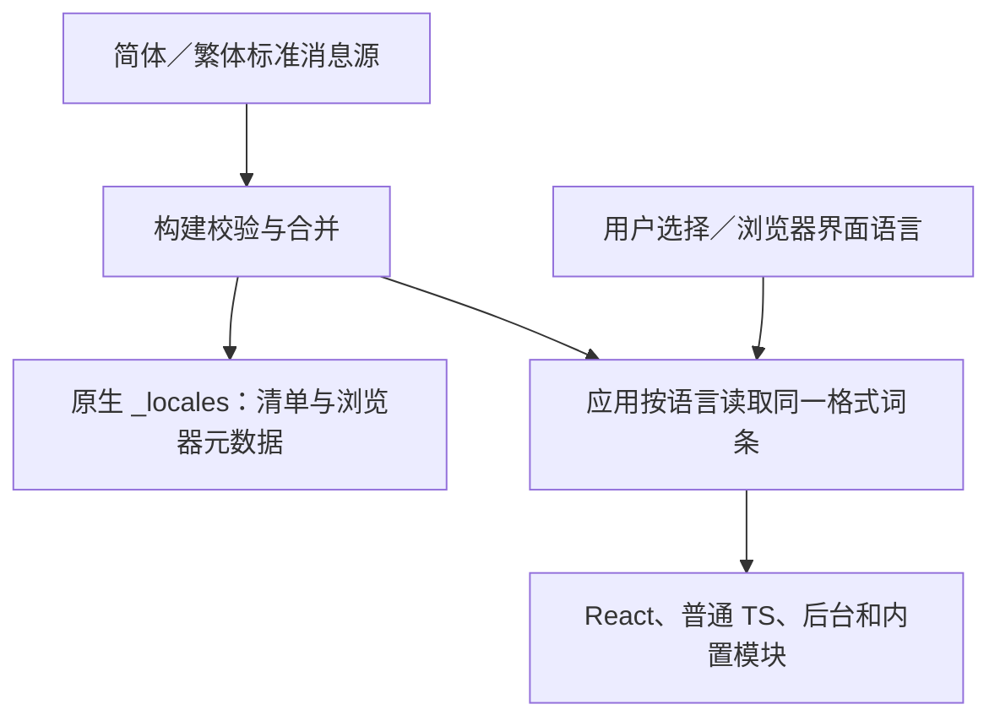

# 简繁中文国际化调研与方案建议

日期：2026-11-03。项目调查基线：`069324c754614c92f9bc6c74b499956a117c1fd1`。

## 1. 结论

浏览器扩展最明确的公共标准是：**稳定的语义词条键、按语言管理的词库、构建输出 `_locales/<locale>/messages.json`，以及浏览器原生 `i18n` 接口**。React 本身不要求采用某个翻译库。

本次拉取的六个产品都使用或构建生成这种标准词库。样本覆盖内容拦截、脚本管理、视频工具、密码管理及文献工具；这是架构对照，不是全行业市场份额统计，不能据此声称某个 NPM 库“市场占有率第一”。

**卡牌大师的首选：标准词库作为唯一翻译来源，配合统一、轻量、有类型的应用翻译入口和语言状态；保留原生元数据国际化，支持应用内选择简体或繁体。**

具体取舍：

- 保留现有 React、Vite、扩展构建和第三方集成，不为简繁适配迁移框架。
- 第一版支持“跟随浏览器界面／简体中文／繁體中文（台灣）”，使用经过审校的台湾繁体措辞。
- 原生清单字段由浏览器选择词条；应用界面和系统生成文案使用统一的有效语言。
- 为应用内手动选择提供有限的标准词库读取、占位符兼容和 React 订阅，不另造翻译语法或完整翻译框架。
- 简繁两套文本使用完整句子的语义键，不在网页运行时遍历 DOM 做繁简转换。
- 用代码和构建校验防止漏翻、占位符错误、跨语言不一致；真实界面和措辞由用户验收。

此建议针对目前的简繁两种中文、多个扩展入口及既有原生词库集成。若范围扩展为多语言复杂复数、性别、上下文或大量富文本消息，应重新评估 `i18next`／ICU 工具，避免持续扩张自有格式处理器。

## 2. 官方机制与边界

依据：[Chrome i18n API](https://developer.chrome.com/docs/extensions/reference/api/i18n)、[Chrome 消息格式](https://developer.chrome.com/docs/extensions/how-to/ui/localization-message-formats)、[Mozilla 扩展国际化](https://developer.mozilla.org/en-US/docs/Mozilla/Add-ons/WebExtensions/Internationalization)。

- `_locales/zh_CN/messages.json` 和 `_locales/zh_TW/messages.json` 是 Chromium 支持的目录命名；应用内部语言标签可采用 `zh-CN`、`zh-TW`，在一个位置完成映射。
- `manifest.json` 的名称、说明、快捷键说明等可以引用 `__MSG_key__`，并声明完整的 `default_locale`。
- 原生 `getMessage()` 根据浏览器选择语言，支持默认词库回退；其参数不包含“指定本次使用哪种语言”。
- `getUILanguage()` 是浏览器界面语言，`getAcceptLanguages()` 是网页语言偏好，两者不能混为一谈。
- 消息格式支持 `description`、命名占位符、位置替换和美元符号转义。语义键应采用可输出为原生消息键的命名，例如 `cm_deck_settings_title`，不要直接把中文句子当键。

[WXT 官方指南](https://wxt.dev/guide/essentials/i18n)同样优先建议原生机制，理由包括同步读取、清单支持和避免各入口重复打包翻译；也明确说明原生方案的语言随浏览器／系统变化。[Plasmo](https://docs.plasmo.com/framework/locales)的默认方案也是标准词库和原生 API。

因此需要区分两种产品能力：

1. 只跟随浏览器：原生 API 加类型约束即可，成本最低。
2. 应用内独立选语言：需要应用语言状态和指定词库的读取能力；单纯包一层 `getMessage()` 无法完成。

应用内手动选择不会改变浏览器扩展管理页由原生清单解析的名称、说明或命令描述。此边界需要在实施和验收中保留，不能承诺调用 `changeLanguage` 就能改变所有浏览器管理界面。

## 3. 已拉取的产品及源码证据

各仓库采用浅克隆，Bitwarden 为稀疏检出；未安装或运行参考项目。以下链接固定到实际检出的提交，避免主分支后续变化影响结论。

| 项目与固定提交 | 实际实现 | 可借鉴之处 |
| --- | --- | --- |
| [uBlock Origin `bc252e3`](https://github.com/gorhill/uBlock/tree/bc252e35781ec8b5b3ff425fcb2a178ff505b457) | [统一入口调用原生 API](https://github.com/gorhill/uBlock/blob/bc252e35781ec8b5b3ff425fcb2a178ff505b457/src/js/i18n.js#L24-L30)；标准 JSON 词库；Crowdin 导入 | 简单的调用边界；翻译文本插入有安全约束；导入脚本检查危险的美元符号使用 |
| [Dark Reader `3c10ec5`](https://github.com/darkreader/darkreader/tree/3c10ec5e94b27662eadaf27bb200fddffa488881) | [薄层读取与回退](https://github.com/darkreader/darkreader/blob/3c10ec5e94b27662eadaf27bb200fddffa488881/src/utils/locales.ts)；[源码配置编译为标准 JSON](https://github.com/darkreader/darkreader/blob/3c10ec5e94b27662eadaf27bb200fddffa488881/tasks/bundle-locales.js) | 源码格式可以不同，输出继续遵循浏览器标准；[词条结构有自动校验](https://github.com/darkreader/darkreader/blob/3c10ec5e94b27662eadaf27bb200fddffa488881/tests/unit/config/locales.tests.ts) |
| [SponsorBlock `454c2d8`](https://github.com/ajayyy/SponsorBlock/tree/454c2d8545d52107de6edbc14e24a67af6c35fb3) | React 18；[组件直接调用原生词条](https://github.com/ajayyy/SponsorBlock/blob/454c2d8545d52107de6edbc14e24a67af6c35fb3/src/popup/SegmentSubmissionComponent.tsx#L20-L27)；Crowdin 与独立翻译子模块 | 与本项目 React 技术栈接近；原生消息同样可用于 React；不同浏览器构建有词条适配 |
| [Violentmonkey `6168de7`](https://github.com/violentmonkey/violentmonkey/tree/6168de714325f6e304b8bcca7cddca7b544f60ad) | Vue；[统一 `i18n` 入口](https://github.com/violentmonkey/violentmonkey/blob/6168de714325f6e304b8bcca7cddca7b544f60ad/src/common/util.js#L5)；YAML 词库经[构建补默认值并生成 JSON](https://github.com/violentmonkey/violentmonkey/blob/6168de714325f6e304b8bcca7cddca7b544f60ad/gulpfile.js#L130-L139) | 与用户脚本管理场景接近；语义键、翻译上下文、抽取和 Transifex 协作；界面语言与脚本本身的元数据语言分别处理 |
| [Zotero Connector `e942336`](https://github.com/zotero/zotero-connectors/tree/e942336f9a3671944c34abf5d35864d73265d5c1) | React 界面经 `Zotero.getString` 取词；[Chromium／Firefox 使用原生 API](https://github.com/zotero/zotero-connectors/blob/e942336f9a3671944c34abf5d35864d73265d5c1/src/browserExt/i18n.js#L26-L49)；[Safari 自行加载同格式词库](https://github.com/zotero/zotero-connectors/blob/e942336f9a3671944c34abf5d35864d73265d5c1/src/safari/i18n.js#L31-L95) | 同一调用接口容纳平台差异；后台读取词库后供内容脚本使用，避免为此公开全部资源 |
| [Bitwarden Clients `5a68808`](https://github.com/bitwarden/clients/tree/5a68808b9dd7a4a8bcb57bca06e958e6f98fb3ad) | 标准 JSON 词库；[浏览器翻译服务代理原生 API](https://github.com/bitwarden/clients/blob/5a68808b9dd7a4a8bcb57bca06e958e6f98fb3ad/apps/browser/src/platform/services/i18n.service.ts#L90-L114)；共享服务集中管理语言和占位符 | 翻译入口、语言状态和界面框架分离；通过 Crowdin 流程维护多端词库。共享服务的 `setLocale` 不能被当作浏览器原生消息支持任意语言切换的证据 |

补充核对：

- SponsorBlock 翻译子模块实际固定到 [`166548e`](https://github.com/ajayyy/ExtensionTranslations/tree/166548e90223a11c57713439080c1903b8853bd6)。该快照英文有 616 键、台湾繁体有 555 键，繁体缺少 61 个英文键。能找到繁体文件，不等于翻译完整。
- 同次调查的 uBlock Origin 英文、简体、繁体文件各有 328 键。相同键数仍需结合键集合、占位符及翻译质量判断。
- Zotero Safari 源码注明了带引号位置占位符的兼容问题，并绕过原生格式化自行读取。这里记录的是上游实现和作者说明，没有在本机浏览器复现该平台问题。
- 未初始化 Zotero 的全部桌面应用子模块，也未执行任何项目的安装脚本或页面测试；现有源码足以核对上述调用与构建路径。

## 4. 卡牌大师当前约束

### 4.1 自有代码与构建

- 粗略静态扫描发现 209 个非测试 TS／TSX 文件含汉字，其中 48 个为 TSX。这个数量包含提示词、错误、注释等，只能估计分布范围，不能当作精确待翻译条数。
- 牌库和设置文案直接分布在 `src/features/userscript-deck`，新标签页和 AI 界面也有独立文案。
- `extension/manifest.common.json` 的产品名、说明和命令提示是固定简体；其他平台清单也有标题文本。
- `extension/*.html` 的 `lang` 和页面标题固定为简体。
- `scripts/package-extension.mjs` 的 `validateSingleLocaleRoot` 明确只接受 `zh_CN`。Lumno、Cat Catch 和 SponsorBlock 的合并流程也写死了简体路径。
- 多处日期格式直接使用 `zh-CN`；用户脚本显示元数据优先 `zh-cn` 再 `zh-tw`，尚未跟随应用语言。

### 4.2 内置第三方模块

当前已检入的四套原生简体词库共 2061 键，分别是：

| 模块 | 当前词条数 | 接入注意点 |
| --- | ---: | --- |
| Lumno 新标签页 | 636 | 原生取词及已生成的独立界面代码；需要检查其语言缓存和首次初始化 |
| YouTube SponsorBlock | 615 | 已有 `sponsor_youtube_` 命名空间及运行时适配层 |
| Bilibili SponsorBlock | 471 | 已有 `sponsor_bilibili_` 命名空间及运行时适配层 |
| Cat Catch | 339 | 现有消息包含 6 项命名占位符定义；另有初始化时生成的文本常量 |

这些统计针对本项目当前文件。上游示例的缺失比例不能直接当作本项目的覆盖率；导入繁体时必须对齐我们固定的上游版本和实际使用键。

当前 Lumno 与 Cat Catch 原始键集合重叠为 0，尚未观察到这两套词库相互覆盖。现有合并使用对象展开，未来新增词条仍应增加重复键检测和明确的命名空间策略。

第三方模块已经存在原生词库调用与适配点，因而标准格式的收益高于仅针对 React 另建一套独立词库。

### 4.3 AI、用户数据与静态素材

- `assistant-tools.ts` 明确要求始终使用简体；每日回顾的规划提示、服务提示和界面说明也写有简体要求。
- 每日回顾的 `dailyReviewPromptUsesChinese` 实际检查汉字范围及连续英文，不会精确区分简体和繁体。应调整提示和文案，再按实际需要设计验证，不能误称当前验证器一定拒绝繁体。
- 用户对话、脚本源码、用户命名、URL、选择器、协议字段和既有数据身份不能被语言转换改写。
- 卡面和品牌素材可能包含已绘入图片的文字，需要单独盘点。仅完成代码词条迁移时，不能自动宣称所有图像文字已经繁体化。

## 5. 方案比较

选择顺序是：先满足简繁覆盖、应用内独立选择、多入口和既有第三方集成，再比较新增运行时、构建复杂度与维护成本。语言数量、复杂消息需求或产品行为改变时应重新选型；不将当前判断包装成不受条件影响的“全局最优”。

| 方案 | 适用优势 | 主要成本／限制 | 本项目判断 |
| --- | --- | --- | --- |
| 仅原生 `i18n`＋薄类型入口 | 标准、同步、清单可用、第三方容易对接 | 无应用内独立语言选择；跨平台和缺键仍需测试 | 如果只要求跟随浏览器，是最小方案 |
| 原生标准词库＋统一应用语言读取层 | 同一词库兼顾清单、React、普通 TS 和第三方；支持手动选语言 | 需要有限的选库、标准占位符兼容、状态广播和初始化处理 | **本项目首选**，实现范围需保持有限 |
| `@wxt-dev/i18n` | 扩展专用类型封装、翻译编辑体验；可在非 WXT 构建中使用 | [官方明确仍随浏览器语言](https://wxt.dev/i18n)，不能单独解决手动选语言 | 只跟随浏览器时可选；不为使用它迁移框架 |
| `i18next`＋`react-i18next` | [应用内切换及 React 订阅成熟](https://react.i18next.com/latest/usetranslation-hook)，多语言复杂消息的工具较完整 | 新增依赖；清单仍需原生词库；需处理现有原生格式、普通 TS、第三方及构建接入 | 作为范围扩张后的备选；仅简繁时新增能力利用率有限 |
| FormatJS／React Intl | ICU 消息、日期数字和复杂国际化能力 | [需配置 React 及非 React 调用](https://formatjs.github.io/docs/react-intl/api/)，也要接原生清单与第三方格式；迁移面较大 | 当前需求无明显额外收益 |
| 运行时整页繁简转换 | 初期改动表面上较少 | 容易误动用户内容和脚本、无法保证地区用词，且掩盖缺失覆盖 | 不采用 |

没有对各库做生产包体积实测，表中的成本是结构性判断，不给出未经测量的 KB 数字。也不以仓库星数或抽样数量代替工程取舍。

## 6. 推荐架构与行为约定

### 6.1 一套词库，两个消费位置

- 自有源词库采用两份原生格式 JSON，可放在 `src/locales/zh_CN/messages.json` 与 `src/locales/zh_TW/messages.json`。构建产物与运行时缓存由它们生成或读取，不再人工维护第二套翻译。
- 自有键统一使用 `cm_` 前缀；第三方继续保留来源和清晰的命名空间。合并时遇到未声明覆盖的重复键直接失败。
- `message` 使用完整语句；`description` 说明场景、语气和变量含义；动态值通过标准占位符传入。日期和数字使用有效语言下的 `Intl`。
- 应用只有一个取词入口，业务代码不自行读 JSON 或猜测语言。可通过默认词库的键类型约束调用，并用构建校验保证两语言键集合和参数一致。
- 手动选库所需的兼容范围包括实际使用的命名占位符、位置参数、大小写和美元转义。以标准语义及测试为准，不通过一次 `.replace()` 假装完整兼容。
- 保留原生接口的自动选词能力用于浏览器元数据。应用文案始终按统一解析出的有效语言读取并缓存词库，偏好为自动和手动时使用同一套读取规则，避免两条路径产生不同的语言或占位符语义。

### 6.2 语言选择和回退

- 偏好值仅保存 `auto`、`zh-CN` 或 `zh-TW`，默认 `auto`；旧配置缺字段或字段非法时回到默认。
- 自动模式以浏览器界面语言为准，API 不可用时才使用宿主可获得的语言信息；不根据当前网站的 `lang`、IP 或猜测用户籍贯选语言。
- 解析标签时显式 `Hans`／`Hant` 优先于地区。`zh-Hant`、`zh-TW`、`zh-HK`、`zh-MO` 选择当前提供的繁体词库；`zh-Hans`、`zh-CN`、`zh-SG` 等选择简体。未支持的语言回退简体，保持现有产品默认。
- 将香港／澳门标签映射到当前繁体词库，只是产品回退策略，不表示台湾繁体措辞等于香港或澳门本地化；未来需要单独适配时新增词库。
- 缺词条时回退完整简体源词库，最后才暴露诊断用键名。运行时回退用于容错；发行前仍要检查繁体缺失，避免长期简繁混杂。
- 建议语言偏好作为本机界面偏好保存。复用现有设置持久化和消息机制；普通跨设备配置同步默认不覆盖另一设备的界面语言。完整备份是否恢复该偏好需明确声明并测试，不能因旧备份缺字段重置当前选择。

以上是推荐的产品语义，不是本轮已实现的功能。

### 6.3 多入口一致性与初始化

- 后台管理语言偏好和有效语言，相关入口读取同一快照；已有存储变化或消息通道负责广播。
- React 在语言变化时重新渲染，不重建整棵界面来切换语言，避免丢失未保存的输入、滚动或会话状态。
- 轻量入口继续保持轻量，只提前拿入口所需文本；完整面板激活后再载入其所需资源。不要把四套第三方词库打进每一个入口。
- 语言资源来自本地扩展包；不增加远程翻译服务、CDN、用户追踪或翻译请求。
- 不为读取词库就把全部 `_locales` 加入网页可访问资源。内容脚本或主世界集成需要通过现有宿主／桥接提供受控数据。
- 调整模块顶层固定标签数组和初始化时生成的文本缓存，避免切换语言后只有新组件换语言。
- 自有 HTML 的标题与 `lang` 在初始化时更新；对注入网页的界面设置自身宿主语言，不修改网站的根 `lang`。
- 第三方原生 API 调用通过其现有局部适配边界接入有效语言，不全局篡改浏览器 API。静态界面或缓存文本若必须刷新，给出明确生效行为，并列入验收，不能静默留下混合语言。

### 6.4 AI 与数据安全边界

- 新生成的系统回复、摘要和用户可见提示跟随语言偏好；用户明确要求其他语言时尊重该次要求。
- 只替换输出语言约束，保留工具协议、JSON 键和有明确用途的英文图像描述要求。
- 历史会话、现有回顾和用户脚本不回写转换；用户脚本优先显示对应本地化元数据，没有时尊重作者原名与描述。
- 脚本 `id`、身份比较、同步标识、存储键和协议枚举保持稳定，不能把翻译后的显示名称用于身份判断。
- 自有翻译默认按文本或 React 节点渲染；含用户值的替换不得直接拼入不受保护的 HTML。第三方渲染保留其安全边界。
- 技术诊断保留原始错误供排查；面向用户的常见错误可本地化解释，不粗暴转换任意第三方异常字符串。

## 7. 台湾繁体措辞规范

翻译维持项目既有的友好、专业、克制风格。字形转换可辅助生成草稿，地区措辞和上下文必须审校。

| 简体源词 | 台湾繁体建议 |
| --- | --- |
| 设置 | 設定 |
| 扩展／插件 | 擴充功能 |
| 默认 | 預設 |
| 加载／重新加载 | 載入／重新載入 |
| 刷新网页 | 重新整理網頁 |
| 新标签页 | 新分頁 |
| 视频／全屏 | 影片／全螢幕 |
| 数据／信息 | 資料／資訊 |
| 链接／网络 | 連結／網路 |
| 文件／文件夹 | 檔案／資料夾 |
| 保存 | 儲存 |
| 禁用／启用 | 停用／啟用 |
| 右键菜单 | 右鍵選單 |

“牌陣”“秘典司書”“順手牽羊”等产品命名保持一致。Chrome、Edge、Firefox、Safari 等名称保留原文。指引用户操作浏览器时，对照相应浏览器的真实菜单名称，不强行统一各浏览器不同的术语。

## 8. 后续实施阶段及验收

后续实施属于跨模块任务，应沿用本目录维护执行文档并设置独立的实施 Goal；本轮 Goal 仅覆盖调研交付。

### 阶段 A：基础能力和词条清单

- 明确自有 UI、后台用户提示、AI、第三方界面、素材和文档的覆盖清单。
- 建立简繁词库、有限的标准格式读取、类型约束、语言解析、偏好持久化及广播。
- 将构建的单语言断言改为受支持语言断言；清单字段接原生消息，保留默认回退。
- 验证旧配置、非法输入、浏览器语言标签映射、占位符和跨入口状态变化。

### 阶段 B：自有界面与系统输出

- 按牌库／设置、新标签页、AI、安装和权限界面迁移，涵盖按钮、说明、空状态、错误、工具提示和无障碍标签。
- 日期、数字、页面标题、语言属性和脚本本地化元数据显示跟随有效语言。
- AI 新输出支持繁体，保持原协议和历史数据不变。

### 阶段 C：第三方界面、素材和完整覆盖

- 对齐已固定上游版本导入繁体，核对新增、缺失及不再使用的键，补齐所需翻译。
- 沿现有 SponsorBlock、Cat Catch、Lumno 适配和构建点接入，不手改大段生成压缩代码。
- 盘点卡面、图片和品牌字样，明确需要本地化的资源及保留的品牌标识。
- 记录必须刷新的第三方界面，完成构建和交接。

### 代码与构建验收

- 两语言自有键集合、必要非空值、重复键、命名及位置占位符一致，已声明的品牌／来源例外单独记录。
- 检查新增用户可见硬编码中文；允许技术提示词、测试夹具、用户内容等有依据的例外，避免把所有汉字都当作漏翻。
- 针对普通文案、变量含美元符号／HTML 字符、缺参、未知键、回退及 Safari 路径做单元测试。
- SSR／组件级检查两语言关键内容；切换不改数据身份，不丢未保存状态，不覆盖用户脚本源码。
- 覆盖后台重启、刷新、多标签页、设置并发更新、旧配置和备份／同步兼容。
- 确认两个原生语言目录与必要词条进入 Chromium、Firefox、Safari 及新标签页变体；构建包不包含调研仓库或运行期远程词库依赖。
- 运行项目既有必要检查，在 `main` 分阶段及时提交并推送；固定 `extension-dist` 更新后交接测试。

### 用户效果验收

- 浏览器简体、繁体以及英文界面下，验证自动与手动选择的明确行为。
- 检查牌库、设置、AI、新标签页、安装界面和内置第三方工具是否混杂简繁。
- 检查较长措辞、按钮、提示、卡面、无障碍标签及未保存表单；必要时覆盖缩放和小窗口。
- 三种浏览器核对占位符、菜单引导和需要刷新的界面；原生清单与应用内手动语言的边界符合说明。
- 确认繁体用词自然，AI 新输出遵循偏好，旧数据及用户内容保持原样。

智能体仅进行代码级验证和构建；本清单的页面操作与视觉确认由用户完成。

## 9. 本轮交付与未验证项

- 已完成六个项目的固定版本源码调研、官方机制核对、当前代码和四套内置词库清点。
- 已形成选型比较、首选架构、语言行为约定、术语表及后续实施和验收清单。
- 只新增调研文档；没有修改功能代码、安装依赖、改变远端仓库或发布对外消息。
- 未运行参考项目，未测量候选库的实际生产体积，也未操作浏览器页面或完成繁体界面效果验收。
- 来源、计数和架构证据已核对；首选方案仍需在后续实施中通过代码、构建和用户效果验收验证。
